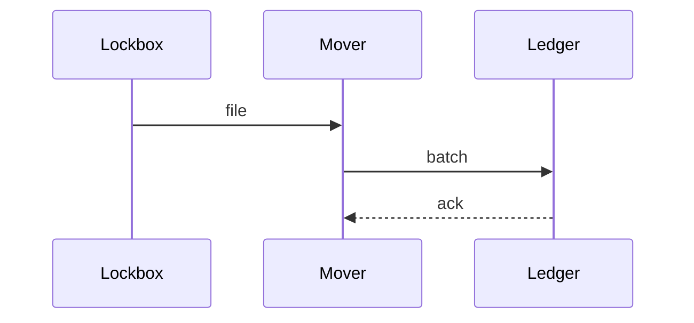

# One cash mover cutover — handoff

Written Nov 18, 2026.

## State

Cutover runs in three steps.

## Open

- [x] Dev cut over
- [ ] UAT cut over

See [05](../modules/one-cash-mover/issues/05-build-movecash.md#q3) and [map](../modules/remove-service-account/map.md).
