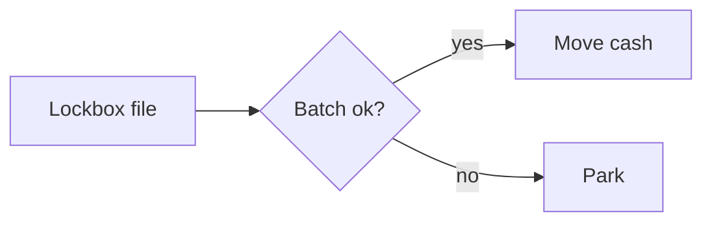

# 04 — Build the move-cash step

Status: built Nov 16, 2026 on claude/ocm-movecash
Type: build
Blocked by: 03

## Why

Part of the cash-handling-workflow work. See the [map](../map.md).

## To do

- [ ] Write the change
- [x] Agree the scope

## Done when

- The change is merged and verified.

## Flow

Cross-space: [one-cash-mover 05 Q3](../../one-cash-mover/issues/05-build-movecash.md#q3).

## Outcome

*(empty)*
